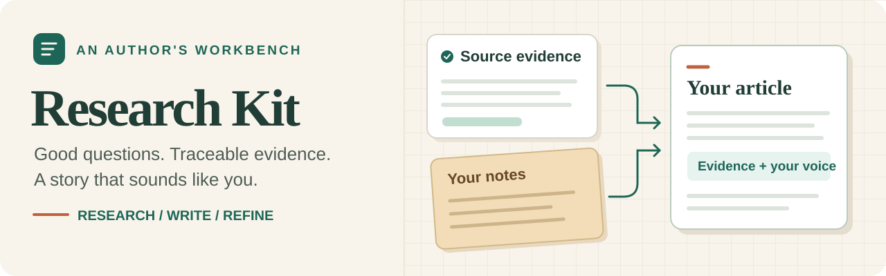
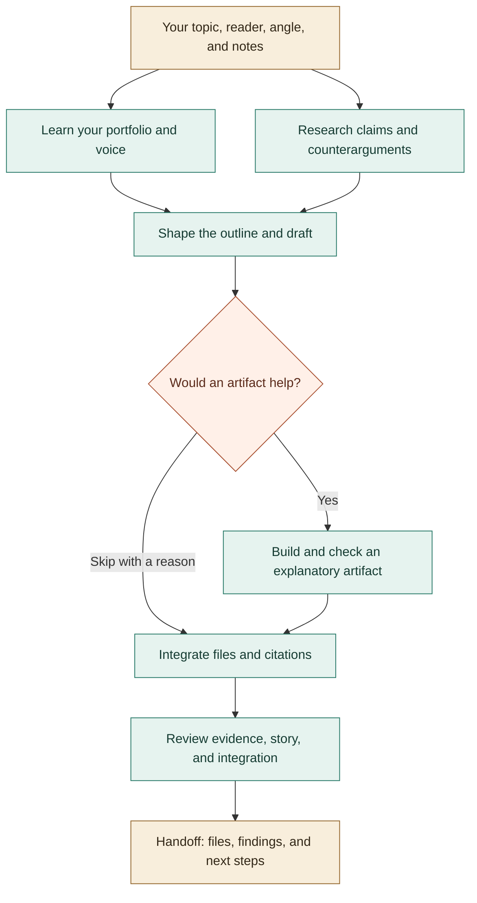

# Research Kit



**Bring your ideas. Build the evidence. Keep your voice.**

Seven agent skills, reusable templates, and a dependency-free handoff helper for technical articles. Start with research or develop a full portfolio contribution. You own the argument, experience, and voice.

[Quick start](#quick-start) · [How it flows](#how-it-flows) · [Meet the skills](#meet-the-skills) · [Workflow guide](docs/workflow.md) · [Roadmap](docs/roadmap.md)

## What do you want to make?

| Your goal | Start here | You'll get |
| --- | --- | --- |
| **Explore a question** before writing | [Research skill](skills/research-technical-article/SKILL.md) | A research brief, a claim-to-source evidence ledger, counterarguments, and open questions |
| **Develop an article** from your notes | [Portfolio workflow](skills/portfolio-blog-workflow/SKILL.md) | Research, an outline and draft, optional explanatory artifacts, proposed repository files, and review findings |

**Research-only requests stop at research.** You can also use any specialist skill independently when you already have the inputs it needs.

## Quick start

### 1. Give your agent the skills

Ask your agent to read the linked `SKILL.md` for your chosen path directly from this checkout, or install the complete skill folders through your host's supported mechanism.

For the full workflow, keep all seven folders under `skills/` together as siblings so the coordinator can find its helpers. A standalone specialist can be used on its own.

### 2. Bring a question and a little context

Share your **topic, intended reader, tentative angle, and notes**. Choose where the work should stop: research, a draft, repository changes, or an explicitly authorized PR/publication action.

For portfolio work, also select the repository and a few writing samples. The agent uses those files to learn your conventions and voice.

### 3. Start a conversation

**Try a research request** — copy this and adapt the topic:

```text
Read skills/research-technical-article/SKILL.md and use it to investigate
when microfrontends justify their operational cost.

Reader: engineers considering a migration.
Tentative angle: team autonomy matters more than frontend scale.

Challenge that angle, separate documented evidence from inference,
and prepare research I can use to tell my own story.
Save outputs under .research-kit-runs/microfrontends/.
```

This is an example question, not a conclusion about microfrontends. It assumes no personal work history or private repository access.

**Ready to develop an article?** Replace the bracketed fields with your own details and authorized file or repository locations:

```text
Read skills/portfolio-blog-workflow/SKILL.md and help me develop an article.

Title: [working title]
Reader: [who this is for and what they should learn]
Angle and notes: [talking points, experience, and questions]
Portfolio repository: [path or URL]
Writing samples: [two or three post paths or URLs]
Output workspace: [article-specific directory]

Inspect the repository and samples for conventions and voice.
Challenge my angle through research, then develop an outline and draft.
Create a demo only if it explains something useful, reuse existing
components, integrate citations, and review the result.
Stage proposed repository files in my output workspace. Do not publish.
```

Review the evidence, editorial decisions, and actual files as the work develops. For local commands, handoffs, and resuming work, see the [workflow walkthrough](docs/workflow.md).

## How it flows

For research alone, the handoff is a **brief + evidence ledger + open questions**. For a full article, the coordinator connects these stages:



Context and research can run independently; drafting waits for both. Review findings return to the stage that needs correction. See the [workflow guide](docs/workflow.md) for handoffs and revisions.

## Meet the skills

| Skill | Its job | What it hands back |
| --- | --- | --- |
| [portfolio-blog-workflow](skills/portfolio-blog-workflow/SKILL.md) | Coordinate the work and keep revisions in sync | Run state, task packets, final handoff |
| [understand-portfolio](skills/understand-portfolio/SKILL.md) | Learn from your selected repository and posts | Verified repository context, editable writing profile |
| [research-technical-article](skills/research-technical-article/SKILL.md) | Investigate sources and challenge claims | Research brief, evidence ledger |
| [compose-technical-article](skills/compose-technical-article/SKILL.md) | Turn evidence and author intent into a story | Outline, draft, talking-point summary, editorial decisions |
| [build-article-artifacts](skills/build-article-artifacts/SKILL.md) | Make an optional example, demo, or visual | Staged assets/code, assumptions, check report |
| [integrate-portfolio-article](skills/integrate-portfolio-article/SKILL.md) | Fit the article to the actual repository | Staged files or authorized edits, citations, integration report |
| [review-portfolio-article](skills/review-portfolio-article/SKILL.md) | Check the evidence, narrative, and integration | Findings, responsible stages, review verdict |

## Good to know

- **You stay in control.** The agent must not invent your experience. Repository changes default to staged proposals; publishing requires authorization. `ready-for-author` means a review handoff.
- **Keep outputs separate.** Use an article workspace outside the installed skills, preferably outside this public repository. `.research-kit-runs/` is ignored for local trials. Keep private material out of public commits.
- **Bring your own agent tools.** Search, models, editing, and previews come from your host. Missing access and unrun checks must be disclosed; local files do not imply local AI processing.
- **Node.js 18+ is optional** unless you use the handoff helper or package checks. The helper tracks work; it does not run AI or publish. Without Node, handoffs can be maintained in conversation without executable validation.

## Check the package

With Node.js 18 or newer:

```sh
node scripts/check-skill.mjs
node --test tests/check-skill.test.mjs tests/workflow.test.mjs
```

Checks cover package structure, local links, and handoff behavior—not factual accuracy or portfolio rendering. Explore the [research scenarios](evals/scenarios.md), [workflow scenarios](evals/workflow-scenarios.md), and [source-limited trial](evals/workflow-forward-result.md) for evaluation details; see the [roadmap](docs/roadmap.md) for what's next.

<details>
<summary>Design influences and references</summary>

- [Agent Skills specification](https://agentskills.io/specification)
- [STORM and Co-STORM](https://github.com/stanford-oval/storm)
- [Lyra review documentation](https://docs.trylyra.ai/concepts/review-scores/)
- [Lex style and editing features](https://lex.page/about)

Design influences only; no endorsement or equivalent performance is claimed.

</details>
