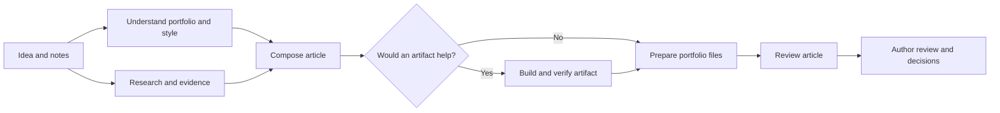
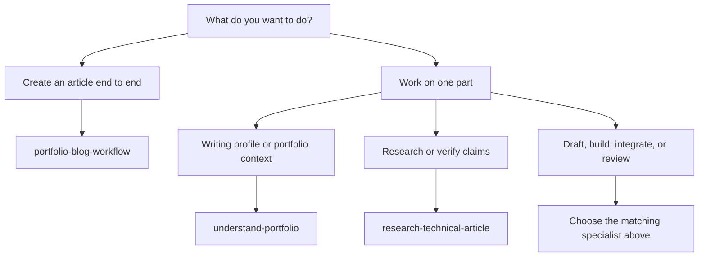

# Research Kit


Turn a technical question or a handful of rough notes into a well-researched article that sounds like you. Research Kit is a set of seven skills that helps your AI assistant research, write, and prepare articles for your portfolio—with you in control of the final decisions.

Start with an idea, a question, or a few talking points. You don't need a polished outline.

## Quick start

**1. Install the skills.** In a terminal, open your private writing workspace (one per author and portfolio). With Node.js 22.20 or later installed, run:

```sh
npx skills add sushilburagute/research-kit
```

Select all seven skills and your coding agent, such as Codex or Claude Code. Open the workspace in your agent and start a new session. Using Claude or ChatGPT chat instead? See [other setup options](#choose-your-setup).

**2. Share an idea.** Try this prompt, replacing the topic and notes with your own:

> Use portfolio-blog-workflow to write about when a cache makes reads slower. My notes: cache misses add a network round trip; invalidation and stale data can complicate the design. Help me prepare a draft for review.

You can start with just a question if that's all you have. On your first article, the workflow can help set up your writing profile. Give it your portfolio and a couple of writing samples if you have them, or describe your preferred style. You can also ask it to decide when you're unsure about length or tone.

**3. Review the result.** You'll get a draft and the material needed to check it. Publishing happens only when you ask for it.

## What you get

- **An article draft** shaped around your topic, audience, and writing style.
- **An evidence ledger** connecting factual claims to their sources, so you can check the research.
- **Proposed portfolio files**, adapted to your site's conventions when the assistant can inspect them.
- **An editorial and technical review**, including open questions and checks performed.

The exact output depends on the tools and access available to your assistant. You can also use the research skill on its own without drafting an article.

## How it works

1. **Learn your style.** The kit creates an editable writing profile from your preferences and any samples you provide.
2. **Research the question.** It investigates your angle, looks for evidence, and records sources and limitations.
3. **Write and prepare.** It turns the research and your notes into a draft, with useful examples or artifacts where appropriate, and stages portfolio files for review.
4. **Review together.** It checks the article and explains what needs your attention. You decide what to change and whether to publish.

The workflow coordinates these stages while keeping your review and publication decisions in your hands:



## Skills and when to use them

Each specialist can also be used on its own with the relevant inputs.

| Skill | What it does and when to use it |
| --- | --- |
| [portfolio-blog-workflow](skills/portfolio-blog-workflow/SKILL.md) | Coordinates the full article process; use it to go from an idea or notes to a reviewable portfolio contribution. |
| [understand-portfolio](skills/understand-portfolio/SKILL.md) | Builds a writing profile and discovers portfolio conventions; use it for initial setup or article context. |
| [research-technical-article](skills/research-technical-article/SKILL.md) | Investigates a topic and tracks evidence and counterarguments; use it to research or verify claims, including without writing an article. |
| [compose-technical-article](skills/compose-technical-article/SKILL.md) | Shapes notes and research into an outline and draft; use it when you want to write an article. |
| [build-article-artifacts](skills/build-article-artifacts/SKILL.md) | Creates and checks diagrams, examples, or demos; use it when an artifact would clarify an article. |
| [integrate-portfolio-article](skills/integrate-portfolio-article/SKILL.md) | Fits a draft, citations, and artifacts to a portfolio's conventions; use it to prepare repository-ready changes. |
| [review-portfolio-article](skills/review-portfolio-article/SKILL.md) | Checks evidence, editorial quality, and the integrated article; use it to assess readiness and identify corrections. |

Choose an entry point based on what you need:



## Choose your setup

### Codex, Claude Code, and other coding agents

Use the [quick-start command](#quick-start) to install with the [skills CLI](https://github.com/vercel-labs/skills). The install is project-scoped by default; add `-g` to install for your user across projects. See the CLI's documentation for supported agents and options. Ask for a skill by name; Codex also supports syntax such as `$portfolio-blog-workflow`.

Alternatively, for Codex, use the included installer with Git and Node.js 18 or later:

```sh
git clone https://github.com/sushilburagute/research-kit.git
node research-kit/scripts/install.mjs .
```

The included installer copies all seven skills into the project's `.agents/skills/` and skips existing folders. To try the kit without installing, ask your agent to read `skills/portfolio-blog-workflow/SKILL.md` from the checkout.

### Claude and ChatGPT chat

The CLI installs skills for supported coding agents; it does not install them into Claude or ChatGPT chat accounts. For Claude, follow its [custom skills instructions](https://support.claude.com/en/articles/12512198-how-to-create-custom-skills) to package and upload skill folders, including their resources. For ChatGPT chat, provide the relevant `SKILL.md` and supporting files as conversation or project context and ask it to follow them. For either chat, provide the other skill folders when the workflow calls for them.

File access, web research, scripts, and handoffs depend on the product and tools available in the session. The workflow also supports manual handoffs without Node.

## Make it yours

You can set up your writing profile before starting an article. For example, the kit's creator might use [sush.dev](https://sush.dev/) and select [How AI Quietly Made Me a Multi-Stack Engineer](https://sush.dev/blog/how-ai-quietly-made-me-a-multi-stack-engineer) and [Spotify API Integration with NextJS](https://sush.dev/blog/spotify-api-integration-with-nextjs) as writing samples:

> Use understand-portfolio to initialise my portfolio in this workspace. My portfolio is https://sush.dev. Use it and these articles to learn my byline, audience, and writing style: https://sush.dev/blog/how-ai-quietly-made-me-a-multi-stack-engineer and https://sush.dev/blog/spotify-api-integration-with-nextjs. I like drafting with enough detail to cut later.

Replace the URL and samples with your own, and include a local repository path if you want the assistant to inspect your site's conventions. If you don't have a portfolio or published posts yet, share your preferences instead.

Edit the resulting `writing-profile.md` whenever your preferences change. Each new article in the workspace takes its own copy. For a one-off change, include it in your article request—for example, “use a shorter, more conversational tone for this post.”

## Research without writing an article

> Use research-technical-article to investigate when a cache makes reads slower. Challenge my angle and give me the evidence.

Replace the question with your own. For stage details, CLI commands, and resuming a run, see the [workflow guide](docs/workflow.md).
